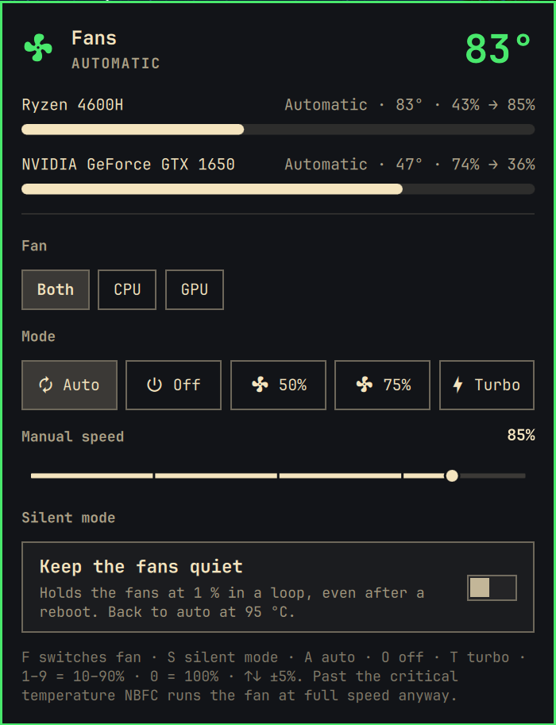

# omafan

Fan control for Omarchy, in the spirit of Acer's NitroSense. A fan icon in the bar
turns red when the machine runs hot; click it (or pick **omafan** in the app launcher,
`Super + Space`) for a panel with every fan's temperature and speed, presets (auto, off, 50 %, 75 %, turbo), and a
manual speed slider. The CPU and GPU fans can be driven together or one at a time,
and a **silent mode** keeps them quiet for the night, even after a reboot.



Unofficial community plugin. It is a front end for
[NBFC-Linux](https://github.com/nbfc-linux/nbfc-linux), which does the actual fan
control by talking to the laptop's embedded controller.

## Requirements

- Omarchy 4 with the Quickshell bar.
- `nbfc-linux` with a config for your laptop and its service running:

  ```bash
  yay -S nbfc-linux
  sudo nbfc rate-config -a              # find a config that fits this machine
  sudo nbfc config --set "<config name>"
  sudo systemctl enable --now nbfc_service
  ```

  Tested on an Acer Nitro AN515-44 (`Acer Nitro AN515-44` config). Any laptop NBFC
  supports should work; the panel shows whatever fans the config defines.

omafan itself never asks for root. It runs the unprivileged `nbfc` client, which talks
to `nbfc_service` over its socket.

## Install

```bash
omarchy plugin add https://github.com/rob-d3v/omafan --enable
```

To also open it from the app launcher (`Super + Space`):

```bash
~/.config/omarchy/plugins/io.github.rob-d3v.omafan/launcher.sh install
```

This writes `~/.local/share/applications/omafan.desktop` and nothing else.

## Use

| Where | What |
| --- | --- |
| Bar icon, click | Open or close the panel |
| Bar icon, right click | Show or hide the temperature next to the icon |
| `F` | Switch between both fans, the CPU fan, and the GPU fan |
| `S` | Silent mode on or off |
| `A` | Automatic (NBFC's temperature curve) |
| `O` | Off: stop the chosen fan (or both) |
| `T` | Turbo, 100 % |
| `1`–`9`, `0` | Fix the speed at 10–90 %, or 100 % |
| `↑` `↓` | Speed up or down by 5 % |
| `←` `→`, `Enter` | Move between presets and apply one |
| `Esc` | Close |

From a script or a key binding:

```bash
omarchy-shell io.github.rob-d3v.omafan toggle
```

A fixed speed stays after the panel closes, until you choose Auto again. When a fan
goes past the config's critical temperature, NBFC runs it at full speed whatever was
asked, and the panel says so. That also holds for Off: a stopped fan starts again
at full speed once the critical temperature is reached.

## Silent mode

For when the laptop has to keep working while you sleep. NBFC's curve and the
laptop's firmware keep nudging the fans back up; silent mode is a small user
service (`silence.sh`) that holds them at 1 % and puts them back every second.
It also switches the power profile to power-saver while it runs.

Turn it on with the **Silent mode** switch in the panel or `S`. It survives logout
and reboot until you turn it off. Picking any mode in the panel (Auto, Turbo, a
speed) turns silent mode off first, so the panel never fights it.

From a terminal:

```bash
P=~/.config/omarchy/plugins/io.github.rob-d3v.omafan
$P/silence.sh install        # on
$P/silence.sh remove         # off, fans back to auto
$P/silence.sh status         # silent=on|off tuned=yes|no
OMAFAN_FANS=0 $P/silence.sh install   # hold only the CPU fan, GPU fan stays free
```

Other settings, read when it is turned on: `OMAFAN_SPEED` (default 1 %),
`OMAFAN_INTERVAL` (seconds, default 1), and the safety limits `OMAFAN_MAX_C`
(default 95 °C: fans go back to auto) and `OMAFAN_RESUME_C` (default 80 °C: silent
again).

Why 1 % and not 0: on the Acer Nitro the embedded controller treats a 0 write as
"decide yourself" and spins the fan up on its own; 1 % keeps the fan stopped.

### Quieter still (optional, root)

```bash
sudo $P/silence.sh tune      # undo: sudo $P/silence.sh untune
```

`tune` writes a copy of the laptop's NBFC config to `/var/lib/nbfc/configs` (NBFC
prefers it and package updates leave it alone) with the critical temperature at
98 °C instead of 90 °C, a 5 °C instead of 15 °C exit margin, a 200 ms EC poll, and
the manual-mode registers rewritten on every fan write. It also turns CPU boost off,
now and at every boot (`/etc/tmpfiles.d/omafan-tune.conf`): the CPU stays at its
base clock and makes far less heat. `OMAFAN_CRITICAL_C`, `OMAFAN_POLL_MS`, and
`OMAFAN_MAX_FREQ_KHZ` (cap the clock, off by default) change those.

### What it cannot do

Silent mode asks; the hardware decides. Above the critical temperature NBFC runs
the fans at full speed anyway. And some firmwares (the Acer Nitro's included) spin
the fans up on their own when their internal sensors warm up, around 58–60 °C on
the CPU, whatever NBFC writes. On a lightly loaded machine silent mode is quiet;
under heavy load expect the firmware to step in now and then. Less heat (boost off,
fewer busy processes, a cooling pad) is what keeps it quiet then.

## Remove

```bash
~/.config/omarchy/plugins/io.github.rob-d3v.omafan/silence.sh remove
~/.config/omarchy/plugins/io.github.rob-d3v.omafan/launcher.sh remove
omarchy plugin remove io.github.rob-d3v.omafan
```

To give fan control back to the BIOS, stop NBFC: `sudo systemctl disable --now nbfc_service`.

## Development

```bash
node --test test/
omarchy plugin validate .
```

`Model.js` holds the parsing and the commands and is tested under node. `Widget.qml`
is the bar icon and panel, built on Omarchy's `Panel`, `KeyboardPanel`, and controls.
`silence.sh` is silent mode and its optional root tuning.

## License

MIT. See [LICENSE](LICENSE).
